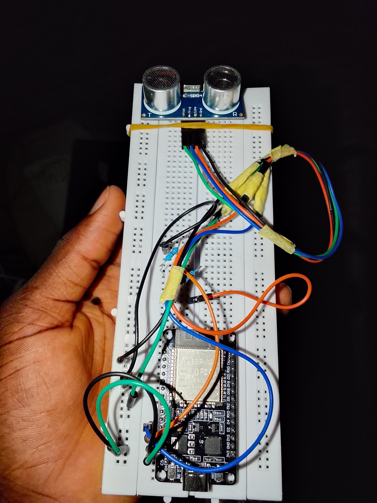

# 💧 Solar-Powered IoT Smart Water Tank Monitoring & Automatic Control System

An ESP32-based smart water tank monitoring system designed to measure water level, process the sensor data, and provide real-time monitoring through a local web dashboard.

The project is being developed as a solar-powered IoT system, with future expansion toward automatic pump control and remote/cloud-based monitoring.

---

## 📌 Project Overview

Manually checking the amount of water available in a storage tank can be inconvenient, especially when the tank is located on a rooftop or in an area that is not easily accessible.

This project explores how an embedded system can be used to automatically monitor the water level and make the information available digitally.

The current implementation uses an **HC-SR04 ultrasonic sensor** connected to an **ESP32**. The sensor measures the distance between the sensor and the surface of the water. The ESP32 processes this measurement and converts it into an estimated water-level percentage.

The ESP32 also connects to a local Wi-Fi network and hosts a web dashboard that allows the current water level to be viewed from another device connected to the same network.

---

## 🎯 Project Goals

The main goals of this project are to:

- Measure water level without physically contacting the water.
- Process sensor measurements using an ESP32.
- Convert measured distance into an estimated water-level percentage.
- Provide real-time local monitoring through Wi-Fi.
- Develop a user-friendly web dashboard.
- Design the system around solar-powered operation.
- Eventually introduce automatic pump control.
- Eventually move the monitoring system from a local network to cloud-based remote monitoring.

---

## 🏗️ Current System Architecture

The current monitoring system follows this flow:

HC-SR04  
↓  
ESP32  
↓  
Distance Measurement  
↓  
Water-Level Calculation  
↓  
Wi-Fi  
↓  
Local Web Server  
↓  
Web Dashboard

The current implementation is intentionally focused on the monitoring stage before introducing automatic pump control and cloud connectivity.

---

## 🔧 Hardware Components

### Main Components

- ESP32 development board (30-pin)
- HC-SR04 ultrasonic distance sensor
- Resistors for ECHO signal voltage divider
- 5 V power supply/prototype power source
- Jumper wires
- Breadboard/prototype connections

### Planned Solar Power System

The final system is designed around a solar power architecture consisting of:

- 50 W solar panel
- LiFePO4 MPPT charge controller
- 12.8 V 20 Ah LiFePO4 battery
- Fuse/protection
- 5 V buck converter
- ESP32 and connected electronics

The solar power section is part of the overall project design and will be integrated into the complete outdoor installation.

---

## 🔌 HC-SR04 Connections

The current sensor connections are:

| HC-SR04 | ESP32 |
|---------|-------|
| VCC | 5 V |
| GND | GND |
| TRIG | GPIO 12 (D12) |
| ECHO | GPIO 13 (D13) through voltage divider |

### ⚠️ ECHO Voltage Protection

The HC-SR04 operates with a 5 V supply and its ECHO output can produce a 5 V signal.

The ESP32 uses 3.3 V GPIO logic, so the ECHO signal is reduced before being connected to GPIO13.

The current voltage-divider arrangement is:

HC-SR04 ECHO  
↓  
1 kΩ resistor  
↓  
GPIO13  
↓  
2 kΩ resistor  
↓  
GND

This reduces the approximately 5 V ECHO signal to a level suitable for the ESP32 GPIO.

---
## Project images



## Project Demo Video
[CLick here to check out the project Demo video](https://youtu.be/bvsQro1TBek)

## 📏 How Water-Level Measurement Works

The HC-SR04 does not directly measure the percentage of water in the tank.

Instead, it measures the distance between the sensor and the water surface.

For example:

```text
        HC-SR04
     ┌───────────┐
     │  Sensor   │
     └─────┬─────┘
           │
           │ Distance
           │
           ↓
     ~~~~~~~~~~~~~~~
        Water
